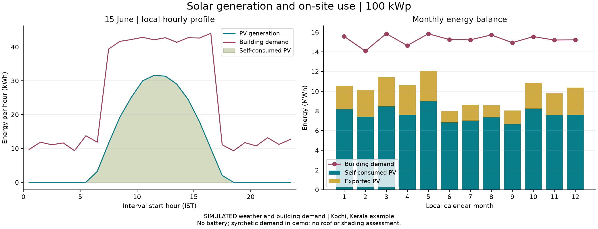
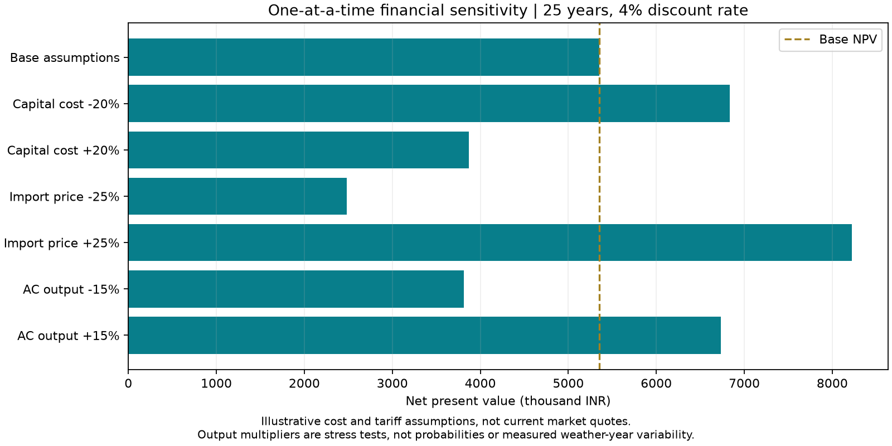
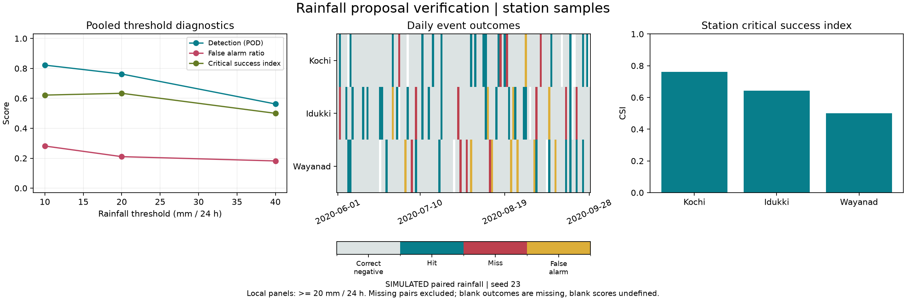
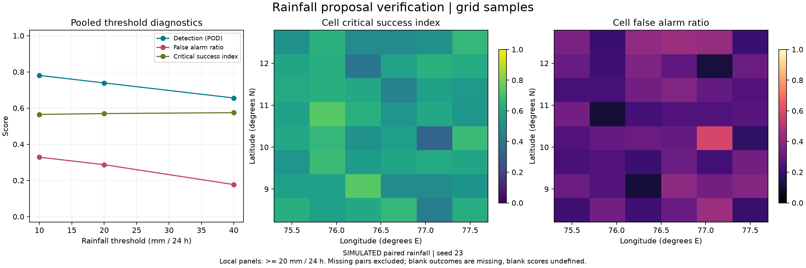
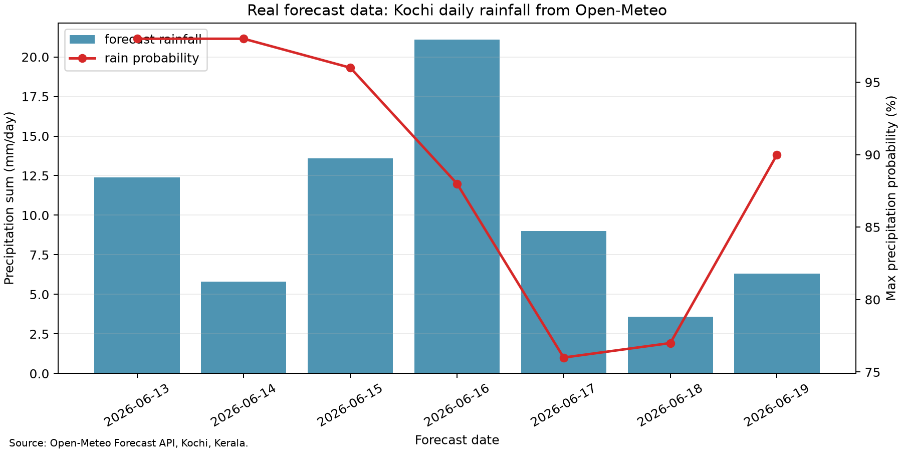

# Kerala Weather Analytics: Rainfall, Solar Energy & Verification

A scientific Python project connecting weather data with **rainfall modelling,
forecast verification and solar-energy analysis** in Kerala, India. Examples
explore local rainfall estimates, threshold-based events, and how variable
sunlight affects on-site electricity use and simplified project economics.

> **Research prototype, not an operational weather or energy service.** Training,
> verification and solar examples use simulated data; financial inputs are
> hypothetical. Separate visualizations use live Open-Meteo forecasts, not
> rainfall observations or predictions from this model. Results are not investment advice.

[Quick start](#quick-start) · [Solar energy](#solar-energy-and-on-site-use) · [Verification](#rainfall-event-verification) ·
[Data](#data-and-scope) · [API](#try-the-api) · [Extensions](#optional-explorations)

## At A Glance

| Component | What it demonstrates | Data |
| --- | --- | --- |
| Rainfall postprocessing | Small PyTorch regressor, feature preparation, MAE/RMSE and heavy-rain detection | Simulated station/NWP-like samples |
| Event verification | Contingency tables, POD, FAR, CSI, frequency bias; station and grid summaries | Simulated paired daily rainfall; prepared netCDF input supported |
| Forecast visualization | Rainfall amount, precipitation probability and spatial displays | Live external Open-Meteo forecasts |
| Solar energy | PV generation, on-site use and financial sensitivity for a Kochi example | Simulated hourly weather and demand; hypothetical INR assumptions |
| Software workflow | Automated tests, GitHub Actions, an example API and container | Local prototype |

## Quick Start

Use **Python 3.13**. Run these commands from the repository root. If an existing
virtual environment uses an older Python version, select a 3.13 interpreter when
creating the environment.

```bash
python3 --version
python3 -m venv .venv
source .venv/bin/activate
python3 -m pip install --upgrade pip
python3 -m pip install -r requirements.txt
python3 -m pip install -e .
python3 -m pytest
```

The editable installation makes the package under `src/` importable from scripts
and notebooks using this environment. Tests check software behavior, not the
accuracy of a real weather forecast.

Train the rainfall model and generate the main diagnostics:

```bash
python3 -m meteo_ml.train --epochs 100
python3 scripts/plot_kerala_demo.py
python3 scripts/verify_rainfall_warnings.py
```

Training saves a checkpoint in `artifacts/kerala_rain_model.pt`. Figures are
written to `figures/`; verification tables and reports go to `products/`.
No download or API key is needed for these simulated examples.

For the solar-energy workflow, install the optional tools and run:

```bash
python3 -m pip install -e '.[energy]'
python3 scripts/analyse_solar_potential.py
```

This adds `pvlib` without making it a requirement for the original rainfall
workflow. Tests that require it are skipped if it is not installed; CI installs
the extra and runs both workflows.

## Solar Energy And On-Site Use

The solar workflow follows the weather-to-energy link for an illustrative
commercial building in Kochi. It uses `pvlib` to estimate solar generation,
matches generation to hourly demand, and compares on-site use, grid imports,
exports and simplified financial outcomes.



The daily profile shows when generation overlaps with demand. Monthly balances
separate self-consumed solar electricity from exports. A second figure compares
the effect of installation cost, import price and output assumptions on net
present value (NPV).



The analysis reports annual generation, self-consumption, self-sufficiency,
net annual benefit, simple payback and NPV. Weather, demand and monsoon cloud
attenuation are **simulated**. INR costs and prices are hypothetical, not current
tariffs or supplier quotes. Output stress tests are not weather probabilities.
This module does not use the rainfall model to predict sunlight.

Useful outputs:

- [Solar screening report](products/solar_energy_demo_report.md)
- [Hourly energy balances](products/solar_energy_demo_hourly.csv)
- [Financial sensitivity cases](products/solar_energy_demo_sensitivity.csv)
- [Assumptions and run metadata](products/solar_energy_demo_summary.json)
- [Solar methods and prepared-data input guide](docs/solar_energy.md)

No battery, heating, CO2 savings or regulatory analysis is included. These are
workflow demonstrations, not a site-specific engineering or investment assessment.

## Rainfall Event Verification

This extension checks whether a proposed daily rainfall exceedance coincides
with a reference exceedance. It uses one xarray-based counting implementation
for station series and gridded arrays, and also accepts matched binary event flags.

```bash
python3 scripts/verify_rainfall_warnings.py
```



The station diagnostic shows score changes across rainfall thresholds, the daily
sequence of hits/misses/false alarms, and CSI at each location. The grid diagnostic
shows the same pooled metrics alongside cell-level CSI and false alarm ratio.



| Metric | Question |
| --- | --- |
| Probability of detection (POD) | How many reference events were detected? |
| False alarm ratio (FAR) | How many proposals were not confirmed? |
| Critical success index (CSI) | How much overlap remains after accounting for misses and false alarms? |
| Frequency bias | Were too many or too few events proposed? |

The demo uses illustrative thresholds of 10, 20 and 40 mm in 24 hours, **not
official warning levels**. Both sides of the comparison are simulated. Results
demonstrate verification code, not real-world warning performance.

Key safeguards include exact coordinate matching, explicit accumulation metadata,
paired missing-data exclusion, and NaN scores when denominators are zero. Counts
are pooled before computing aggregate scores. The grid summary is unweighted.

Useful outputs:

- [Verification report](products/warning_verification_demo_report.md)
- [Pooled threshold scores](products/warning_verification_demo_summary.csv)
- [Station and grid-cell scores](products/warning_verification_demo_locations.csv)
- [Run metadata](products/warning_verification_demo_manifest.json)
- [Methods, formulas, limitations and netCDF input guide](docs/warning_verification.md)

For prepared, independently matched daily data:

```bash
python3 scripts/verify_rainfall_warnings.py --input data/matched_daily_rainfall.nc --threshold 20
```

This does not fetch observations or parse warning bulletins. Matching forecast
lead times, observation quality, accumulation windows and spatial support remains
the caller's responsibility. Exact sample verification is not episode-, polygon-,
impact- or neighborhood-based warning verification.

## Data And Scope

**Simulated rainfall** keeps training, climate examples and verification small
and reproducible. These examples do not establish forecast skill or climate trends.
The verification generator has its own fixed seed and does not evaluate the
trained PyTorch model.

**Simulated solar weather and demand** are generated separately for a Kochi
example with prescribed monsoon cloud attenuation. The energy analysis uses
hourly radiation, temperature and wind, not the rainfall model's output.
Prepared hourly weather and load CSVs are supported under the solar input schema;
their provenance and quality must be checked independently.

**Live forecasts** are used only by the Open-Meteo plotting scripts:

```bash
python3 scripts/plot_real_open_meteo_kochi.py
python3 scripts/plot_real_open_meteo_station_map.py
python3 scripts/plot_real_open_meteo_field_map.py
```



These commands require internet access and may give different results on each
run. Precipitation amount and precipitation probability are different quantities.
The field-style figure interpolates forecasts sampled at API locations; it is
not a native model grid, radar analysis or observed rainfall map.

Prepared netCDF readers are available for specific documented schemas; this is
not a general GRIB/reanalysis ingestion system. Some files require an additional
xarray backend. See the individual method guides before using external data.

## Try The API

```bash
uvicorn meteo_ml.serve:app --reload
```

Open [the interactive API page](http://127.0.0.1:8000/docs) to inspect and test
requests. The server runs until stopped with `CTRL+C`; `--reload` is for local
development. `/health` reports service status and `/stations` lists locations.
`/predict` requires a **POST** request, not a browser GET.

From another terminal:

```bash
curl -X POST http://127.0.0.1:8000/predict \
  -H "Content-Type: application/json" \
  -d '{
    "station": "Kochi",
    "day_of_year": 180,
    "temperature": 298.0,
    "humidity": 0.86,
    "pressure": 1004.0,
    "wind_u": -5.0,
    "wind_v": 1.5,
    "nwp_precipitation": 28.0
  }'
```

The response contains a rainfall estimate, station metadata and a model-version
label. Risk labels are illustrative categories, not official warnings.
**The current API trains a separate small demo model at startup; it does not
load the checkpoint produced by the training command.** Outputs can therefore
differ between runs and from the offline model's evaluation.

### Docker

```bash
docker build -t kerala-rainfall-prototype .
docker run --rm -p 8000:8000 kerala-rainfall-prototype
```

Then open the same `/docs` address. The image runs the example API, not a
scheduled forecasting or verification service.

## Optional Explorations

These follow-ups are separate demonstrations, not prerequisites for the rainfall,
solar-energy or verification workflows.

<details>
<summary><strong>Climate indicators and circulation diagnostics</strong></summary>

Simulated baseline/future ensembles illustrate heavy-rain days, annual maxima,
percentiles and ensemble spread. A second example relates very wet days to a
toy circulation index with a deliberately prescribed association.

```bash
python3 scripts/plot_climate_extreme_scenario.py
python3 scripts/generate_scenario_product_summary.py
python3 scripts/analyse_rainfall_circulation.py
```

These are not climate projections or findings about real circulation.
Read the [scenario guide](docs/climate_scenario_extension.md) and
[circulation methods](docs/rainfall_circulation.md).

</details>

<details>
<summary><strong>Weather-product planning</strong></summary>

An illustrative priority matrix translates hypothetical user needs into product
choices. Weights are assumptions, not requirements collected from real clients.

```bash
python3 scripts/generate_ops_weather_product_brief.py
python3 scripts/plot_ops_weather_decision_matrix.py
```

Read the [product-planning guide](docs/ops_weather_product_extension.md).

</details>

<details>
<summary><strong>Local documentation retrieval</strong></summary>

A lightweight text retriever returns cited excerpts from project documents.
It has **no LLM response generation** and is not a complete generative RAG system.

```bash
python3 scripts/query_scenario_assistant.py "How should users interpret heavy-rain scenario indicators?"
python3 scripts/plot_rag_workflow.py
```

Read the [retrieval guide](docs/genai_rag_extension.md).

</details>

## Repository Map

```text
src/meteo_ml/     Rainfall model, event verification, solar-energy analysis and API
scripts/          Runnable analyses, figures and report generation
tests/            Unit and integration checks
docs/             Workflow descriptions, input contracts and limitations
figures/          Generated visual diagnostics
products/         CSV tables, reports and run metadata
artifacts/        Saved model checkpoint
.github/workflows/ci.yml
Dockerfile
```

GitHub Actions installs the package with the energy extra and runs pytest on Python 3.13. The
verification tests cover hand-calculated scores, missing values, undefined
metrics, coordinate mismatches, threshold equality and station/grid aggregation.
Energy tests check hourly conservation, financial arithmetic, input validation,
PV output and prepared-data round trips. See [the workflow guide](docs/workflow.md)
for the original rainfall pipeline and links to the other methods.

## Current Limitations

The ML example is intentionally small: preprocessing currently fits scaling
before its train/validation split, and training is not seeded. Reported errors
should not be presented as an independent or reproducible forecast benchmark.
The rainfall API, solar-energy analysis, climate experiments and verification
runner are separate workflows, not an integrated operational platform.

A real evaluation would require archived forecasts paired with quality-controlled
observations, a fixed lead-time and accumulation definition, an independent
evaluation period and uncertainty analysis. No performance claim, operational
readiness or affiliation with a meteorological service is implied.
